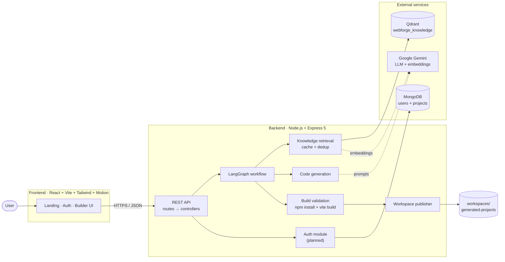
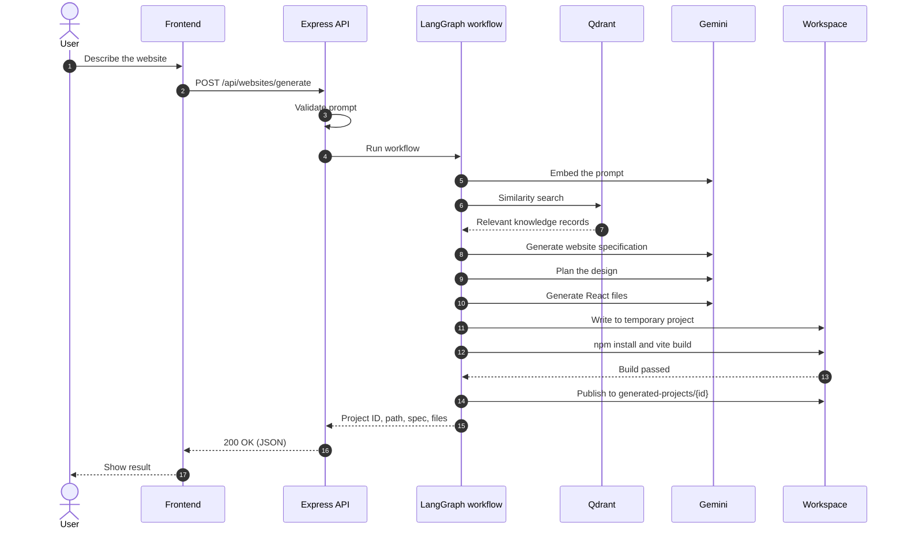
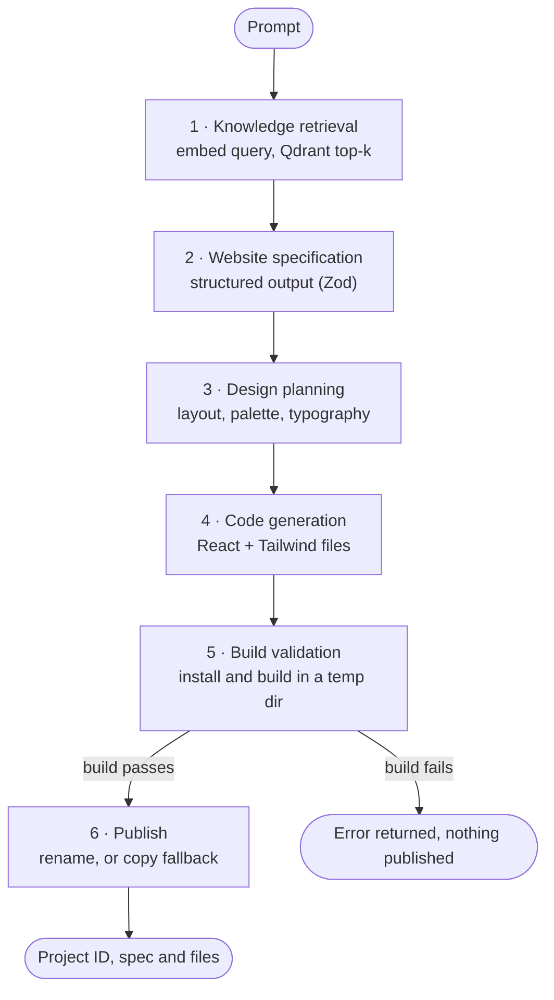
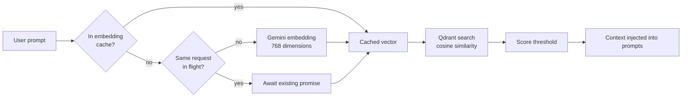
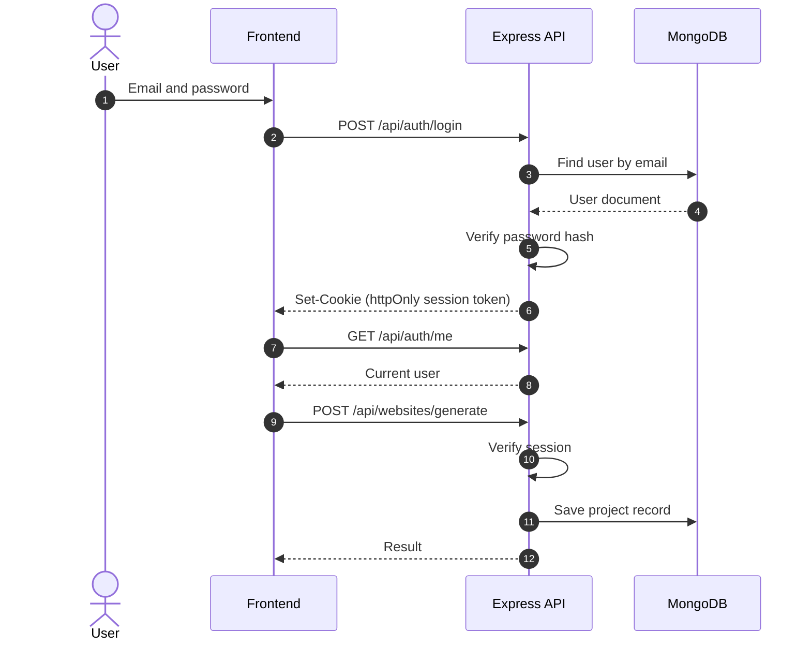
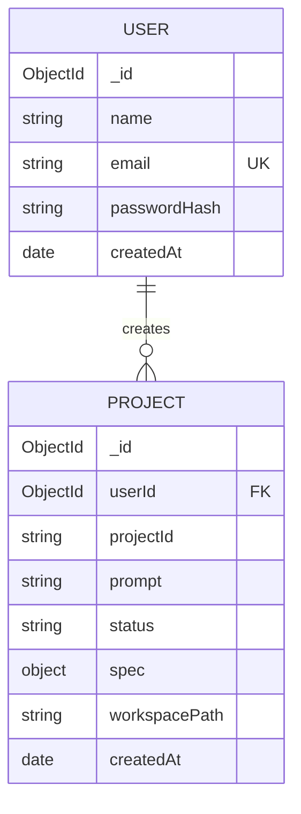

<div align="center">

# DevNexus · WebForge AI

**Describe a website. Get a working, build-verified React project.**

An AI website generator that combines a LangGraph agent workflow, retrieval-augmented generation (Qdrant) and Google Gemini, with an automated production build as the quality gate.


[Overview](#overview) · [Architecture](#architecture) · [How it works](#how-it-works) · [API](#api-reference) · [Getting started](#getting-started) · [Roadmap](#roadmap)

</div>

---

## Overview

WebForge AI turns a plain-English description into a complete React + Vite + Tailwind website.

Most "AI website builders" stop at generating text. WebForge AI treats generated code like any other build artifact: it is written to an isolated directory, dependencies are installed, and a **production build must pass before the project is published**. Generation is grounded by a **Qdrant knowledge base** of design and implementation guidance, so the output follows consistent patterns instead of improvising every time.

### Highlights

| | |
|---|---|
| **Agent workflow** | A LangGraph pipeline with distinct stages: retrieval, specification, design planning, code generation, validation and publishing. |
| **Retrieval-augmented generation** | 768-dimension Gemini embeddings stored in Qdrant (cosine distance), with in-memory caching and in-flight request deduplication. |
| **Build-verified output** | `npm install` and `vite build` run in a temporary workspace. Only projects that pass are published. |
| **Windows-safe publishing** | A copy-based fallback handles `EPERM` and file-lock errors when renaming temporary folders. |
| **Modern frontend** | React, Tailwind and Motion with a landing page, authentication pages and a prompt-driven builder interface. |
| **User accounts** | MongoDB-backed registration, login and per-user project history (see [Roadmap](#roadmap)). |

---

## Status

| Area | State |
|---|---|
| Generation pipeline (retrieval → spec → design → code → build → publish) | Implemented and tested |
| Qdrant knowledge base and semantic retrieval | Implemented |
| REST API (`/api/health`, `/api/websites/generate`) | Implemented |
| Frontend UI (landing, login/signup, builder) | Built, API wiring in progress |
| MongoDB authentication and project history | Planned, designed below |
| Live preview, ZIP download, progress streaming | Planned |

---

## Architecture



### Request lifecycle



---

## How it works



| Stage | Responsibility | Source file |
|---|---|---|
| Orchestration | Connects the stages as a LangGraph graph | `services/websiteWorkflow.js` |
| Retrieval | Embeds the query and searches Qdrant, with caching and request deduplication | `services/knowledgeRetrievalService.js` |
| Code generation | Produces the React project files from the spec and design plan | `services/websiteCodeService.js` |
| Validation | Installs dependencies and runs a production build | `services/buildValidationService.js` |
| Publishing | Moves the verified project into `generated-projects/` | `services/workspaceService.js` |

### Retrieval design



- **Collection:** `webforge_knowledge`, 768 dimensions, cosine distance.
- **Embedding model:** `gemini-embedding-2` with 768-dimension output.
- **Caching and deduplication:** repeated or simultaneous identical queries cost one embedding call.

### Authentication and user data (MongoDB)

This is the planned design for user accounts and per-user project history.





---

## Tech stack

| Layer | Technology |
|---|---|
| Frontend | React, Vite, Tailwind CSS, Motion, React Router |
| Backend | Node.js 22, Express 5 |
| AI orchestration | LangGraph (`@langchain/langgraph`) |
| LLM and embeddings | Google Gemini (`@google/genai`) |
| Vector database | Qdrant (`@qdrant/js-client-rest`) |
| Validation | Zod |
| Database (users, projects) | MongoDB |
| Config and middleware | dotenv, CORS |

---

## API reference

Base URL (local): `http://localhost:5000`

### `GET /api/health`

Returns service status.

### `POST /api/websites/generate`

Generates a website from a description.

**Request**

```json
{
  "prompt": "Create a modern photography portfolio website"
}
```

**Response (shape)**

```json
{
  "projectId": "<uuid>",
  "projectPath": "workspaces/generated-projects/<uuid>",
  "specification": { "...": "generated website specification" },
  "files": [ { "path": "src/App.jsx", "content": "..." } ]
}
```

**Errors:** invalid or empty prompts are rejected with a client error. If the production build fails, nothing is published.

### Planned endpoints

| Method | Path | Purpose |
|---|---|---|
| `POST` | `/api/auth/register` | Create an account |
| `POST` | `/api/auth/login` | Start a session |
| `POST` | `/api/auth/logout` | End the session |
| `GET` | `/api/auth/me` | Current user |
| `GET` | `/api/projects` | List the user's generated projects |

---

## Getting started

### Prerequisites

- Node.js 22 or newer
- A Google Gemini API key
- A Qdrant instance (Qdrant Cloud or self-hosted) and its API key
- A MongoDB connection string (needed once authentication is enabled)

### 1. Clone

```powershell
git clone https://github.com/sarthak-2233/DevNexus.git
cd DevNexus
```

### 2. Configure the backend

Create `backend/.env` (never commit this file):

```env
PORT=5000
GEMINI_API_KEY=your_gemini_key
QDRANT_URL=https://your-qdrant-endpoint
QDRANT_API_KEY=your_qdrant_key

# Planned: authentication
MONGODB_URI=mongodb+srv://<user>:<password>@<cluster>/devnexus
JWT_SECRET=a_long_random_string
```

### 3. Start the backend

```powershell
cd backend
npm install
node .\src\server.js
```

The API is now at `http://localhost:5000`. Check it:

```powershell
curl http://localhost:5000/api/health
```

### 4. Start the frontend

In a second terminal:

```powershell
cd frontend
npm install
npm run dev
```

Open the URL Vite prints (typically `http://localhost:5173`).

### 5. Try the API directly

```powershell
curl -Method POST http://localhost:5000/api/websites/generate `
  -ContentType "application/json" `
  -Body '{"prompt":"Create a modern photography portfolio website"}'
```

Run a generated project:

```powershell
cd workspaces\generated-projects\<projectId>
npm install
npm run dev
```

> Run one generation at a time while developing. Concurrent requests install dependencies in parallel and can hit file locks on Windows.

---

## Project structure

```text
DevNexus/
├── backend/
│   ├── src/
│   │   ├── server.js
│   │   ├── routes/
│   │   │   └── websiteRoutes.js
│   │   ├── controllers/
│   │   │   └── websiteController.js
│   │   └── services/
│   │       ├── websiteWorkflow.js
│   │       ├── websiteCodeService.js
│   │       ├── buildValidationService.js
│   │       ├── workspaceService.js
│   │       └── knowledgeRetrievalService.js
│   └── package.json
├── frontend/                  React + Vite + Tailwind application
├── templates/                 Base templates for generated projects
├── workspaces/
│   └── generated-projects/    Verified output, one folder per project ID
└── DOCS PHASE WISE/           Phase-by-phase documentation
```

---

## Design decisions

- **Build as a quality gate.** An LLM can produce code that looks right but does not compile. Running a real production build before publishing guarantees that every delivered project at least builds.
- **Isolated temporary workspaces.** Generation happens in a temporary folder and is promoted only after validation, so a failed run never leaves a half-written project behind.
- **Retrieval before generation.** Grounding prompts in curated knowledge makes output more consistent and reduces invented APIs.
- **Embedding cache and request deduplication.** Embedding calls are the most repeated external cost, so identical queries are served from memory or share a single in-flight call.
- **Publishing fallback for Windows.** Renaming a folder can fail with `EPERM` when files are locked. The service falls back to a recursive copy followed by best-effort cleanup.
- **Separation of concerns.** Routes, controllers and services are separate, which keeps the workflow testable and makes adding stages straightforward.

---

## Security

- Secrets live in `backend/.env`, which must stay in `.gitignore`. Rotate any key that was ever committed.
- Prompts are validated before reaching the workflow.
- Generated code is built in an isolated directory, never inside the API process.
- Planned for authentication: password hashing (argon2 or bcrypt), session tokens in httpOnly cookies, rate limiting on auth and generation routes, and strict CORS limited to the frontend origin.

---

## Known limitations

- Generation requests are not queued. Concurrent requests can contend for the file system, particularly on Windows.
- Retrieval sometimes returns zero results for a prompt. The score threshold and knowledge coverage are being tuned.
- The startup log mentions `/api/websites/analyze`, but the registered route is `/api/websites/generate`.

<details>
<summary><b>Troubleshooting</b></summary>

**`'vite' is not recognized as an internal or external command`**
Dependency installation was interrupted. Stop the backend, delete the temporary folder under `workspaces/generated-projects/` (names start with `.tmp-`), and generate again, one request at a time.

**`EBUSY` or `EPERM` during cleanup or publishing**
Another process is holding files open, often a dev server or antivirus scan. Stop dev servers, wait a moment and retry. The publisher already falls back to copying.

**Browser shows a CORS error**
Allow the exact frontend origin (for example `http://localhost:5173`) in the backend CORS configuration.

**Qdrant dimension mismatch**
The collection must use 768 dimensions with cosine distance, matching the embedding output.

</details>

---

## Roadmap

- [x] LangGraph generation workflow
- [x] Qdrant knowledge base and semantic retrieval
- [x] Embedding cache and request deduplication
- [x] Build validation gate before publishing
- [x] Windows-safe publishing fallback
- [x] Frontend UI: landing, authentication and builder pages
- [ ] Connect the frontend to the generation API
- [ ] MongoDB authentication and per-user project history
- [ ] Live preview of generated sites
- [ ] Download generated project as ZIP
- [ ] Stream generation progress to the UI (server-sent events)
- [ ] Job queue to serialize generations
- [ ] Retrieval evaluation (recall, MRR) and threshold tuning
- [ ] Docker setup and CI (lint, build, tests)

---

## Contributing

Issues and pull requests are welcome. For larger changes, open an issue first to discuss the approach.

1. Fork the repository
2. Create a branch: `git checkout -b feature/your-feature`
3. Commit with a clear message
4. Open a pull request

## License

Released under the MIT License. Add a `LICENSE` file to the repository root.

## Author

**Sarthak** · [GitHub](https://github.com/sarthak-2233)

---

<div align="center">

If this project is useful or interesting to you, consider giving it a star.

</div>
